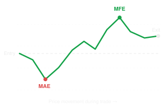

MFE (Maximum Favorable Excursion) and MAE (Maximum Adverse Excursion) are two important metrics for analyzing trading strategies and optimizing stop-loss (SL) and take-profit (TP) levels.

## 1. Definitions

- MFE: The maximum unrealized profit a trade reaches while it is open, measured from the entry price.
- MAE: The maximum unrealized loss a trade experiences while it is open, measured from the entry price.

### Example: US100 long trade



Illustrative long trade: price drops after entry, then rallies before the position closes.

| Metric                     | Price  | Distance               |
| -------------------------- | ------ | ---------------------- |
| Entry                      | 30,000 | —                      |
| Lowest price during trade  | 29,920 | MAE = −80 points       |
| Highest price during trade | 30,250 | MFE = +250 points      |
| Exit price                 | 30,180 | Realized = +180 points |

The trade temporarily moved 80 points against you and 250 points in your favor before closing with a 180-point profit.

## 2. Why are MFE and MAE useful for your ADR strategy?

MAE helps investigate stop-loss placement. For example, if profitable trades typically experience only 60–100 points of adverse movement, you can investigate whether a 300-point stop-loss is unnecessarily wide.

MFE helps investigate take-profit placement. If most trades reach only 40–60% ADR before reversing, setting TP2 at 100% ADR might be unrealistic.

You can also normalize both metrics by ADR:

\\[ \text{MFE/ADR}=\frac{\text{MFE points}}{\text{ADR points}} \\]

\\[ \text{MAE/ADR}=\frac{\text{MAE points}}{\text{ADR points}} \\]

For the example above, with ADR = 400 points:

- MFE = 250/400 = 62.5% ADR
- MAE = 80/400 = 20% ADR

## 3. Important for your Python backtest

For a long trade:

```
mfe = highest_price_during_trade - entry_pricemae = entry_price - lowest_price_during_trade
```

For a short trade:

```
mfe = entry_price - lowest_price_during_trademae = highest_price_during_trade - entry_price
```

These formulas express both metrics as nonnegative distances. Some reporting systems instead show MAE as a negative signed result.

One critical detail: calculate MFE/MAE only within the actual trade's lifetime. If analyzing potential stops and targets, you can also examine a fixed hypothetical holding window without exits, but that must be clearly distinguished from realized trades.

For your project, I'd track MFE/ADR and MAE/ADR for every simulated trade. These will help you investigate appropriate SL and TP distances, identify whether your entry timing is effective, and determine whether the strategy's potential profits justify its risks. Just remember that high MFE does not guarantee an executable profit, and historical distributions alone do not establish a profitable strategy.